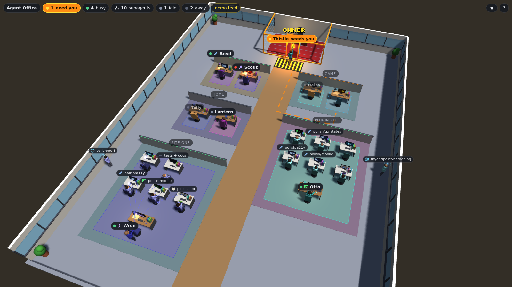
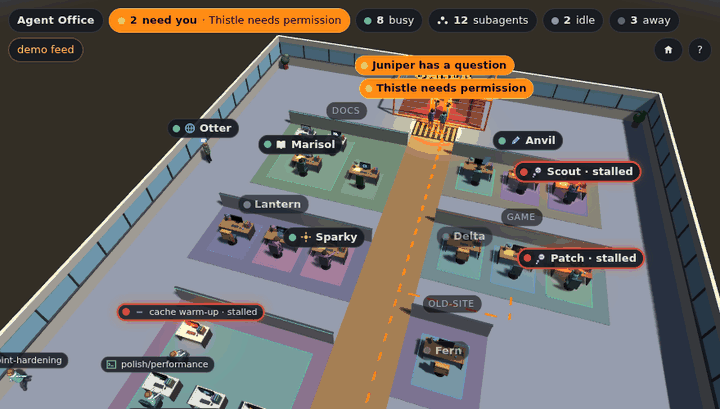
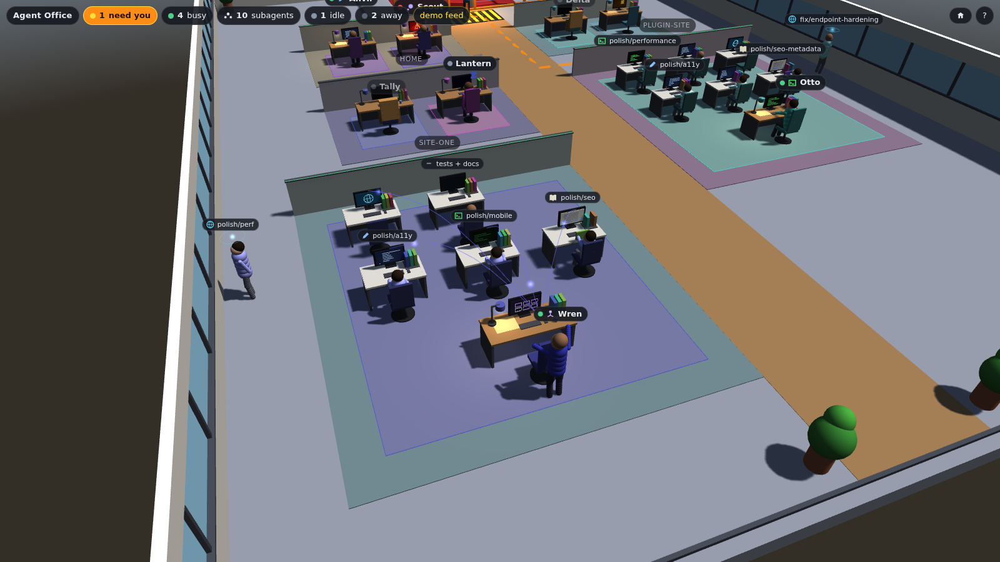
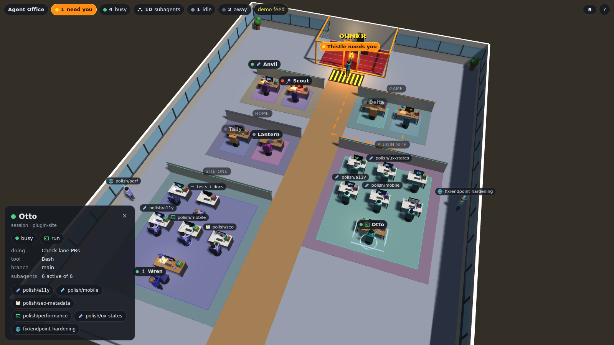
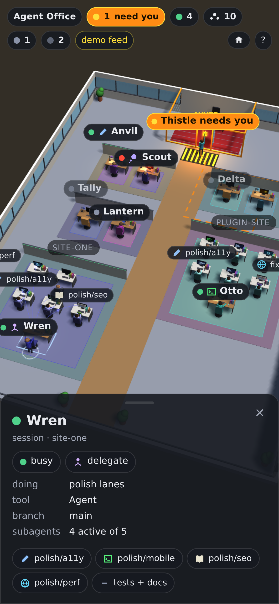
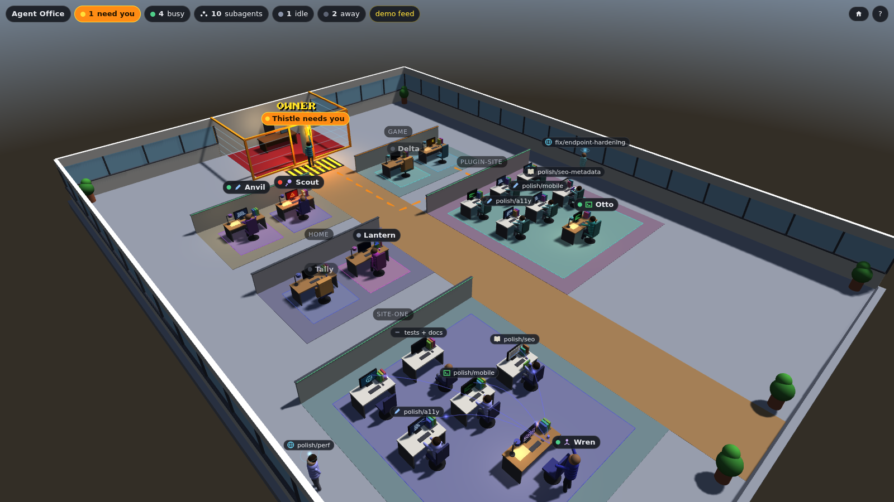
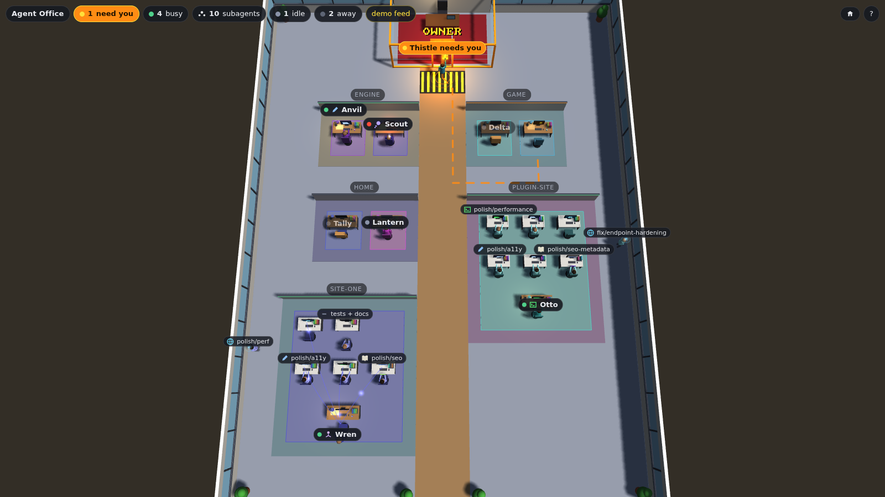

# agentviz-office

Your Claude Code sessions and their subagents as an open-plan office floor,
seen from a 3/4 overhead camera and drawn with
[Strata](https://github.com/Preponderous-Software/strata). Each repo is a team
pod, each session sits at a lead desk with a lamp, and its subagents sit at
satellite desks in the same block. When a session needs you, it gets up,
walks down the corridor to the glass **OWNER** office and holds up a sticky
note at your door.

One of the [agentviz](https://github.com/dmccoystephenson/agentviz) family:
ten views of the same feed.


*The whole floor (demo feed). Two leads (Wren, Otto) with 5 and 6 subagents,
a solo worker and a stalled thinker in `engine`, an idle and an offline desk
in `home`, and Thistle at the owner's door with an orange trail back to its
desk in `game`.*

## Run

```bash
python3 -m vendor.agentfeed serve --web web --port 8841            # your live sessions
python3 -m vendor.agentfeed serve --web web --port 8841 --fixture  # the demo feed
```

Open <http://127.0.0.1:8841/> (the server binds 127.0.0.1 only). Query
options: `?fixture=1` (demo feed), `?demo=1` (demo feed with scripted
changes, to watch people walk and screens change), `?night=1` / `?night=0`
(pin night or day; otherwise the real sun by your local clock), `?fps=1`
(frame stats), `?quality=0|1|2`.

Drag to orbit, right-drag or two fingers to pan, wheel or pinch to zoom. Tap a
person or a desk for its card (a bottom sheet on a phone). The orange
**need you** chip flies the camera to the owner's door and cycles through
whoever is waiting; the house button recentres; **?** opens the legend.

## What you are looking at

| You see | It means | Close-up |
|---|---|---|
| A pod: a carpet with a low partition and a name plate | one place (the working directory's name) | [hero](docs/media/hero.png) |
| A coloured border inside a pod | one session's block: its lead desk at the front, satellites in rows behind | [lead-pod](docs/media/lead-pod.png) |
| Big wood desk, desk lamp, headset, deep shirt | the **lead** (the session) | [lead-pod](docs/media/lead-pod.png) |
| Small white desk, lighter shirt in the lead's colour, lane label over the monitor | a **subagent**, belonging to that lead | [lead-pod](docs/media/lead-pod.png) |
| Lamp on (a Strata point light) | the session is busy | [night](docs/media/night.png) |
| Typing, code lines growing on a blue screen | `edit` | [lead-pod](docs/media/lead-pod.png) |
| Green terminal rows scrolling with a flicker | `run` | [lead-pod](docs/media/lead-pod.png) |
| Holding an open binder (one missing from the desk rack), a page on screen | `read` | [delegate](docs/media/delegate.png) |
| Standing at the window, a blue ping over the head, a globe on screen | `web` | [hero](docs/media/hero.png) |
| The lead standing, pointing at its team; notes flying in arcs to each active lane | `delegate` | [delegate](docs/media/delegate.png) |
| Leaning back, hands behind the head, thought dots rising, slow wave on screen | `think` | [stalled](docs/media/stalled.png) |
| Hand on the mouse, other on the chin, amber bars | `other` | |
| At the **OWNER** office door, sticky note raised, pulsing orange rings and beam, orange dashes from the desk; the door frame glows; "needs you" label and chip | `waiting`: the session needs you | [waiting](docs/media/waiting.png) |
| Lamp off, slumped, Z's drifting up | `idle` (or `dim`) | [idle-offline](docs/media/idle-offline.png) |
| Empty desk, jacket on the chair, screen off | `offline` | [idle-offline](docs/media/idle-offline.png) |
| Monitor flashing red with a warning triangle, red light on the desk | `stalled` (busy, nothing written for 5 min) | [stalled](docs/media/stalled.png) |
| Chair pushed back, screen dim, sitting back | a resting subagent | [resting](docs/media/resting.png) |
| Desks rising from / sinking into the floor | a subagent appearing / leaving the feed | |

## Screenshots

All from the fixture feed (`--fixture` / `?fixture=1`), never live sessions.


*`?demo=1`, six seconds: subagent screens switch between tasks, a lane walks
out to the window for `web` and back, Wren alternates between reading and
delegating (notes fly to its lanes), and a session gets up and walks to the
owner's door.*


*Otto's pod: the lead at the front running a terminal, six subagent desks
behind it, each with its lane label and screen (edit, read, run, web).*


*Wren delegating: standing behind the lead desk and pointing at the team;
notes arc to each active lane. The resting lane's chair is pushed back.*


*Waiting on you: Thistle at the owner's door, sticky note up, rings pulsing,
the door frame and sign burning orange, dashes leading back to its desk.*


*Idle and offline: Lantern slumped at a dark desk with Z's; Tally's desk
empty with a jacket left on the chair.*


*Stalled: Scout has been busy with nothing written for over five minutes, so
the monitor flashes red with a warning triangle.*


*A resting subagent (`tests + docs`): chair pushed back, screen dim.*


*Tap Otto: the card shows state, action, what it is doing, branch, and each
subagent lane as a chip you can tap to jump to it.*



*A phone (390 x 844, DPR 3): touch orbit and pinch, the card as a bottom
sheet, compact chips.*


*Another angle: from the west, lower.*


*Straight down: the plan. Pods either side of the corridor that leads to the
owner's office.*


*Night (`?night=1`, or after sunset by your clock): busy desks' lamps light
their desks and screens glow.*

## Build and test

```bash
scene/build.sh                                   # emsdk 6.0.11 + Strata 0.10.0 -> web/office-engine.{js,wasm}
python3 -m unittest discover -s tests            # serves the fixture; page, assets and feed
NODE_PATH=/root/arcade-watch/node_modules node tests/smoke.cjs        # headless Chromium; saves docs/media/screenshot.png
NODE_PATH=/root/arcade-watch/node_modules node tests/screenshots.cjs  # every image above (or name some: hero phone demo)
```

The built engine files are committed, so serving needs only Python 3.8+. The
tests use port 8941. `vendor/agentfeed/` is vendored from agentviz
(`tools/vendor-feed.sh`); do not edit it here.

## How it works

`web/page.js` polls `/api/agents` every 2 s. `web/office.js` keys everything
by id, lays out pods in two columns either side of a corridor that leads to
the owner's office, gives each subagent a stable desk slot, eases desks to
new positions and walks people along the aisles (out between the desk rows,
down the pod's aisle, then the corridor or the window aisle), with a short
dwell so a quick tool switch does not send anyone back and forth. Each frame
it writes one float buffer to the scene; `scene/main.cpp` draws it with
Strata's primitives, lines, points and point lights.
