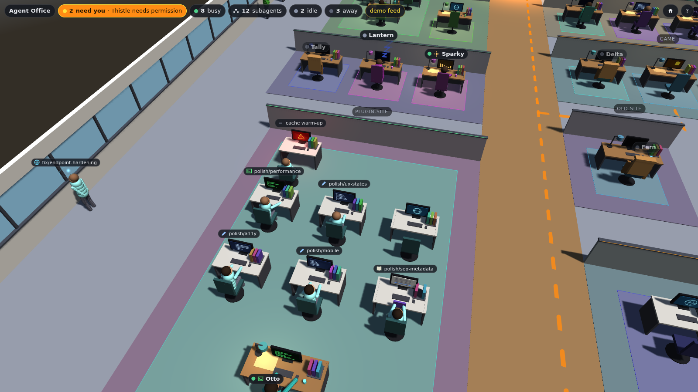
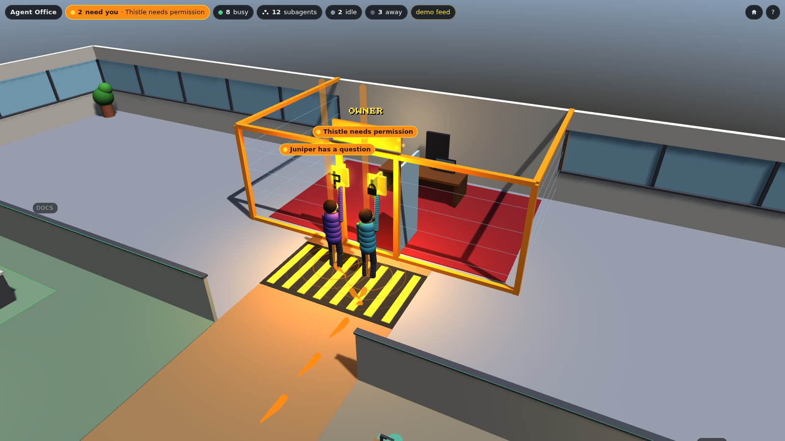
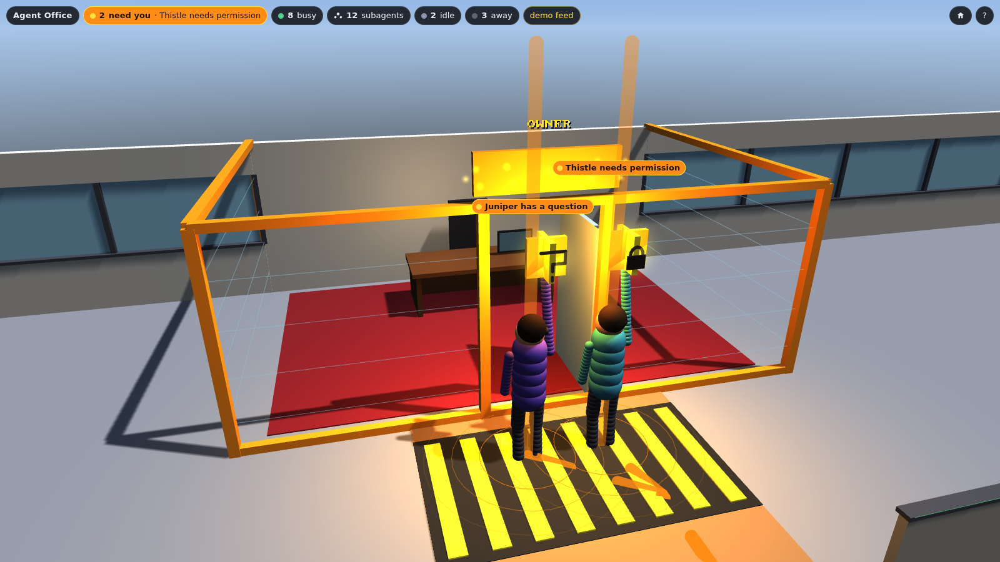
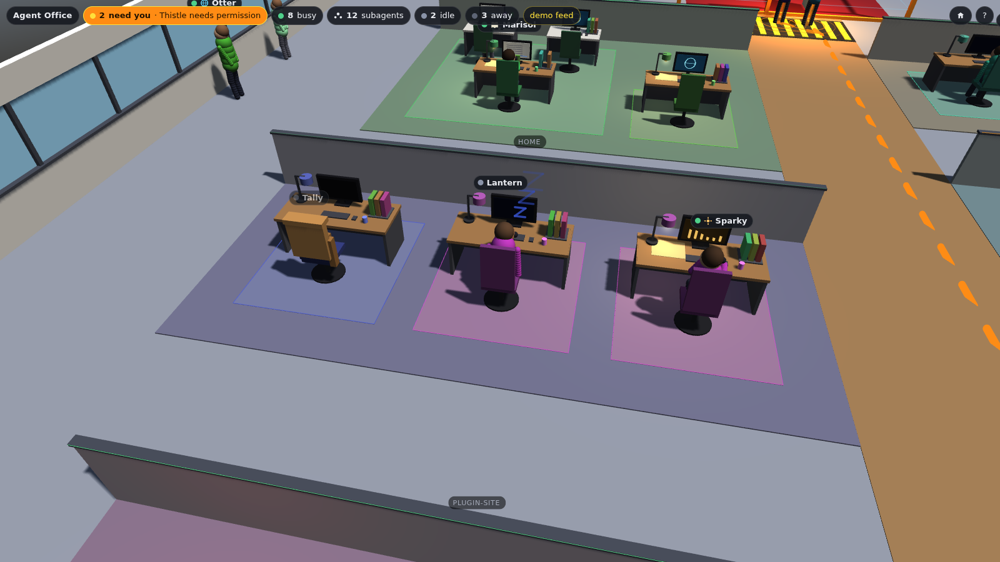
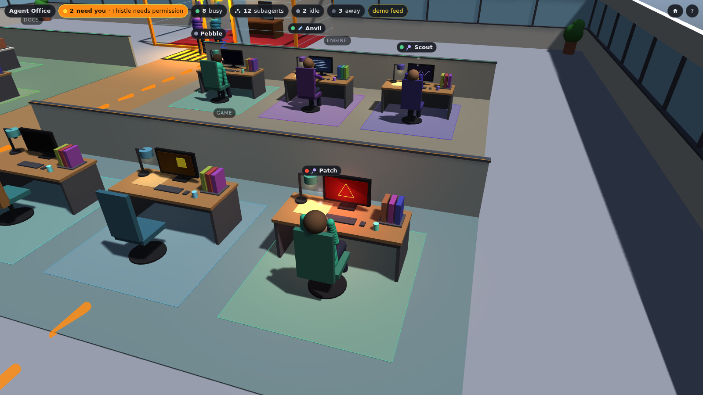
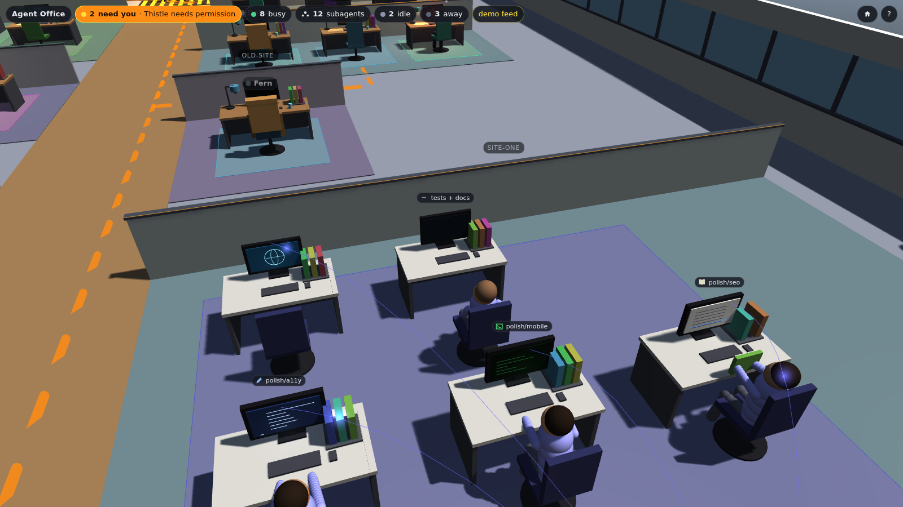
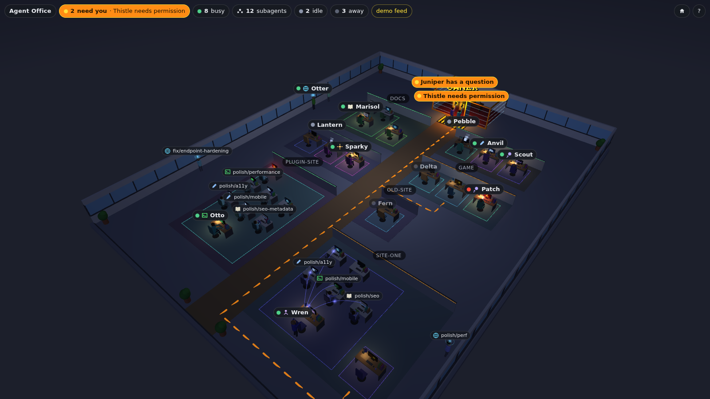

# agentviz-office

Your Claude Code sessions and their subagents as an open-plan office floor,
seen from a 3/4 overhead camera and drawn with
[Strata](https://github.com/Preponderous-Software/strata). Each repo is a team
pod, each session sits at a lead desk with a lamp, and its subagents sit at
satellite desks in the same block. When a session needs you, it gets up,
walks down the corridor to the glass **OWNER** office and holds up a sticky
note at your door.

One of the [agentviz](https://github.com/dmccoystephenson/agentviz) family:
ten views of the same feed.


*The whole floor (demo feed). Two leads (Wren, Otto) with 5 and 7 subagents,
a reader and a web surfer in `docs`, a stalled session (Patch) in `game`, and
Thistle and Juniper at the owner's door with orange trails back to their
desks.*

## Run

Needs Python 3.8 or newer and nothing else:

```bash
git clone https://github.com/dmccoystephenson/agentviz-office
cd agentviz-office
python3 -m vendor.agentfeed serve --web web --port 8841            # your live sessions
python3 -m vendor.agentfeed serve --web web --port 8841 --fixture  # the demo feed
```

Open <http://127.0.0.1:8841/> (the server binds 127.0.0.1 only and refuses
non-local `Host` headers). Live mode reads your Claude Code session files
under `~/.claude` and shows session names, states, git branches, tool names
and short labels (a file's basename, a Bash command's own description, a web
host, a subagent's description), never file contents, commands or prompts;
see the agentviz [SECURITY.md](https://github.com/dmccoystephenson/agentviz/blob/main/SECURITY.md). Query
options: `?fixture=1` (demo feed), `?demo=1` (demo feed with scripted
changes, to watch people walk and screens change), `?night=1` / `?night=0`
(pin night or day; otherwise the real sun by your local clock), `?fps=1`
(frame stats), `?quality=0|1|2`.

Drag to orbit, right-drag or two fingers to pan, wheel or pinch to zoom. Tap a
person or a desk for its card (a bottom sheet on a phone; swipe it down or
tap the cross to close). The orange **need you** chip names who is waiting
and why (a question, or a permission prompt), flies the camera to the
owner's door and cycles through them; the house button recentres; **?**
opens the legend. If the feed stops answering, a banner says so and the last
snapshot stays; with no sessions at all, a hint says how to start.

## What you are looking at

| You see | It means | Close-up |
|---|---|---|
| A pod: a carpet with a low partition and a name plate | one place (the working directory's name) | [hero](docs/media/hero.png) |
| A coloured border inside a pod | one session's block: its lead desk at the front, satellites in rows behind | [lead-pod](docs/media/lead-pod.png) |
| Big wood desk, desk lamp, headset, deep shirt | the **lead** (the session) | [lead-pod](docs/media/lead-pod.png) |
| Small white desk, lighter shirt in the lead's colour, lane label over the monitor | a **subagent**, belonging to that lead | [lead-pod](docs/media/lead-pod.png) |
| Lamp on (a Strata point light) | the session is busy | [night](docs/media/night.png) |
| Typing, code lines growing on a blue screen | `edit` | [lead-pod](docs/media/lead-pod.png) |
| Green terminal rows scrolling with a flicker | `run` | [lead-pod](docs/media/lead-pod.png) |
| Holding an open binder (one missing from the desk rack), a page on screen | `read` | [delegate](docs/media/delegate.png) |
| Standing at the window, a blue ping over the head, a globe on screen | `web` | [hero](docs/media/hero.png) |
| The lead standing, pointing at its team; notes flying in arcs to each active lane | `delegate` | [delegate](docs/media/delegate.png) |
| Leaning back, hands behind the head, thought dots rising, slow wave on screen | `think` | [stalled](docs/media/stalled.png) |
| Hand on the mouse, other on the chin, amber bars | `other` | |
| At the **OWNER** office door, sticky note raised, pulsing orange rings and beam, orange dashes from the desk; the door frame glows; label and chip say why | `waiting`: the session needs you | [waiting](docs/media/waiting.png) |
| A "?" on the raised sticky note / a padlock on it | waiting on a question / on a permission prompt | [question](docs/media/question.png) |
| Lamp off, slumped, Z's drifting up | `idle` (or `dim`) | [idle-offline](docs/media/idle-offline.png) |
| Empty desk, jacket on the chair, screen off | `offline` | [idle-offline](docs/media/idle-offline.png) |
| Monitor flashing red with a warning triangle, red light on the desk | `stalled`: a session busy with nothing written for 5 min, or a subagent quiet that long without finishing | [stalled](docs/media/stalled.png) |
| Chair pushed back, screen dim, sitting back | a resting subagent | [resting](docs/media/resting.png) |
| Desks rising from / sinking into the floor | a subagent appearing / leaving the feed | |

## Screenshots

All from the fixture feed (`--fixture` / `?fixture=1`), never live sessions.


*`?demo=1`, six seconds: subagent screens switch between tasks, a lane walks
out to the window for `web` and back, Wren alternates between reading and
delegating (notes fly to its lanes), and a session gets up and walks to the
owner's door.*


*Otto's pod: the lead at the front running a terminal, seven subagent desks
behind it, each with its lane label and screen (edit, read, run, web); the
stalled lane's monitor flashes red.*


*Wren delegating: standing behind the lead desk and pointing at the team;
notes arc to each active lane. The resting lane's chair is pushed back.*


*Waiting on you: Thistle at the owner's door, sticky note up, rings pulsing,
the door frame and sign burning orange, dashes leading back to its desk.*


*Why they wait: Juniper's note carries a "?" (it asked a question), Thistle's
a padlock (a permission prompt).*


*Idle and offline: Lantern slumped at a dark desk with Z's; Tally's desk
empty with a jacket left on the chair.*


*Stalled: Patch has been busy with nothing written for over five minutes, so
the monitor flashes red with a warning triangle.*


*A resting subagent (`tests + docs`): chair pushed back, screen dim.*


*Tap Otto: the card shows state, action, what it is doing, branch, and each
subagent lane as a chip you can tap to jump to it.*


*A phone (390 x 844, DPR 3): touch orbit and pinch, the card as a bottom
sheet, compact chips.*


*Another angle: from the west, lower.*


*Straight down: the plan. Pods either side of the corridor that leads to the
owner's office.*


*Night (`?night=1`, or after sunset by your clock): busy desks' lamps light
their desks and screens glow.*

## Build and test

```bash
python3 -m unittest discover -s tests       # serves the fixture; page, assets, feed, vendored PINs
npm ci && npx playwright install chromium   # Playwright 1.61.1, for the browser tests
pip install -r requirements-dev.txt         # Pillow, for the GIF
npm run smoke                               # headless Chromium on the demo feed; saves docs/media/screenshot.png
npm run screenshots                         # every image above (or some: npm run screenshots -- hero phone demo)
EMSDK=/path/to/emsdk vendor/agentviz-kit/scene/build-scene.sh scene/kit.conf   # rebuild web/office-engine.*
```

The built engine files are committed, so serving needs only Python. Tests
use port 8911 (`OFFICE_TEST_PORT` overrides). `vendor/agentfeed/`,
`vendor/agentviz-kit/` and `web/agentviz-*` come from
[agentviz](https://github.com/dmccoystephenson/agentviz) (`tools/vendor-kit.sh`);
do not edit them here.

## How it works

The feed client, the HUD (chips, the selected-agent card and bottom sheet,
the banner), world labels, tap picking and the page-to-engine data format are
the shared agentviz kit (docs/KIT.md in agentviz). On top of it,
`web/office-model.js` keys everything by id, lays out pods in two columns
either side of a corridor that leads to the owner's office, gives each
subagent a stable desk slot and eases desks to new positions;
`web/office-walk.js` decides each person's pose, screen and place and walks
them along the aisles (out between the desk rows, down the pod's aisle, then
the corridor or the window aisle), with a short dwell so a quick tool switch
does not send anyone back and forth. Each frame `web/office-frame.js` packs
the scene in the agentviz wire format; `scene/main.cpp` decodes it with
`agentviz.h` and draws it with Strata's primitives, lines, points and point
lights (`room.h`, `desk.h`, `person.h`, `trails.h`).

## Licence

Code: [MIT](LICENSE). Screenshots and GIFs in `docs/media/`:
[CC0 1.0](LICENSE-media). The committed engine bundles Strata (MIT) and its
libraries, and the Emscripten runtime: see
[THIRD_PARTY_NOTICES.md](THIRD_PARTY_NOTICES.md).
